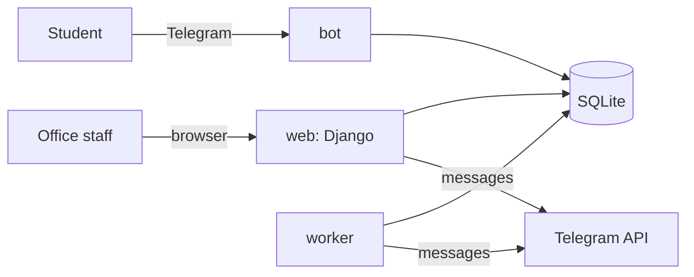
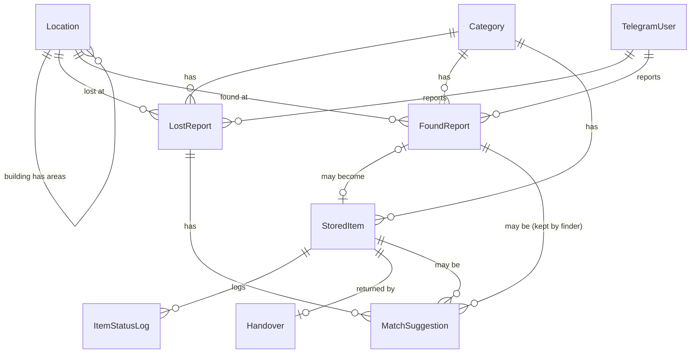

# Campus Lost & Found

A lost-and-found service for a university campus.

- Students report lost and found items in a **Telegram bot** (Uzbek, Russian, English).
- The **office staff** work in a Django web app: receive items, put them on shelves, confirm matches, hand items back to their owners.
- A **worker** runs in the background: it suggests matches, expires old reports and sends a daily digest to the office group.

Live site: `<fill in>` · Bot: `@<fill in>` · Office login: `<fill in>`

## Run it

### With Docker (recommended)

```bash
cp .env.example .env          # then edit .env: SECRET_KEY, BOT_TOKEN, OFFICE_GROUP_ID
docker compose up --build     # web on http://localhost:8000, plus the bot and the worker
docker compose exec web python manage.py createsuperuser      # your real office account
docker compose exec web python manage.py seed_demo            # optional: demo data
```

`web` runs the migrations first; `bot` and `worker` wait until `web` is healthy. All three share one volume that holds the SQLite file and the photos.

### Without Docker

```bash
python -m venv .venv && source .venv/bin/activate
pip install -r requirements.txt
cp .env.example .env
python manage.py migrate
python manage.py seed_demo          # demo data + login  office / office12345
python manage.py runserver          # the office web app
python manage.py runbot             # the Telegram bot   (needs BOT_TOKEN)
python manage.py runworker          # the background jobs
```

`seed_demo --reset` deletes everything and builds the demo data again.

### Railway (one service)

Railway services cannot share a SQLite volume, so run everything in **one** service: the `Dockerfile` default command is `start.sh` (migrate, worker, bot, web). Add a **Volume** mounted at `/data` and set these variables:

| Variable | Value |
| --- | --- |
| `DJANGO_SECRET_KEY` | long random string |
| `DEBUG` | `False` |
| `DATA_DIR` | `/data` |
| `ALLOWED_HOSTS` | your Railway domain, e.g. `xxx.up.railway.app` |
| `CSRF_TRUSTED_ORIGINS` | `https://xxx.up.railway.app` |
| `BOT_TOKEN` | from BotFather |
| `OFFICE_GROUP_ID` | optional, for the daily digest |
| `DJANGO_SUPERUSER_USERNAME` / `DJANGO_SUPERUSER_PASSWORD` | first office login |

Keep the service at **one replica** (two bots polling the same token conflict).

### Telegram setup

1. Talk to [@BotFather](https://t.me/BotFather), create a bot, put the token in `BOT_TOKEN`.
2. For the daily digest: add the bot to the office group and put the group's numeric id in `OFFICE_GROUP_ID` (looks like `-1001234567890`). Use a **test** bot and a **test** group while developing.
3. Without `BOT_TOKEN` the web app and the worker still work; they just skip sending messages.

## How it works



Three processes, one codebase, one database (the Django ORM is the only way to touch it).

| Process | Command | Job |
| --- | --- | --- |
| web | `gunicorn config.wsgi` | office pages, admin, CSV export |
| bot | `manage.py runbot` | wizards for lost/found reports, recent items, "this is mine", my reports |
| worker | `manage.py runworker` | every 10 min: match; every hour: expire old reports; 09:00 Tashkent: digest |

### The two kinds of "found"

A **found report** (`FoundReport`) is a *claim*: "I found a scarf". A **stored item** (`StoredItem`) is the *physical object* on the office shelf. They are different things:

- the finder may keep the item → a found report, no stored item;
- somebody may leave an item at the desk without telling the bot → a stored item, no found report.

### Matching

`matching/scoring.py` gives a lost report a score against an item. A different category is never a match. All weights are constants at the top of that file.

| Rule | Points |
| --- | --- |
| same color | 3 |
| found on or after the day it was lost, within 14 days | 2 |
| same building | 2 (+1 if the same area) |
| each shared word in title/description (stop words ignored) | 1, at most 4 |

A score of **5 or more** creates a suggestion (`created_by = system`). The breakdown is stored and shown to staff ("color +3, date +2, …"), so a match is always explainable. Suggestions can also come from staff (picked by hand) and from the owner (the "This is mine" button).

**Nothing is suggested twice.** The pair (lost report, item) has a unique constraint in the database, and the code uses `get_or_create`. A restarted worker, two workers, or a double click all end the same way. The owner is messaged only when the suggestion is new.

### Item life cycle

```
in_storage ──► returned      (handover: receiver name + last 4 digits of the ID)
           ├─► disposed      (retention period is over)
           └─► transferred   (given to another organisation)
```

- An item leaves storage **once**. `storage/services.py::change_status` is the only function that changes the status; it checks the rule and writes an `ItemStatusLog` row.
- "Return" is one transaction: item → returned, handover created, lost report → returned, found report → returned. It either all happens or none of it.
- Retention: arrival date + the category's days (documents 180, electronics 90, keys 60, clothing 30, …). The digest warns about items that expire within 7 days and lists items past their date. **Only staff dispose of items**; the worker never does.
- A shelf code (`B2-07`) can be used by only one item *in storage* (conditional unique constraint). Returned items free their code.

### Privacy

- Handovers store only the **last 4 digits** of an ID (form, model validator and test all enforce it).
- The finder's Telegram contact is shown to the owner **only** if the finder agreed in the found wizard.
- Telegram photos are kept as `file_id` and downloaded on demand; every uploaded photo is served only to logged-in staff.
- The whole web app (except `/login/`) is staff-only, enforced by one middleware. Accounts that are not staff cannot log in.

### Data model



## Where is what

```
config/      settings, urls, staff-only middleware, login form
catalog/     categories (3 languages, retention days), colors, locations; seed_demo; test helpers
reports/     TelegramUser, LostReport, FoundReport; the lost-reports pages
storage/     StoredItem, status log, handovers; services (rules); dashboard, receive, return, CSV
matching/    scoring.py (the rules), services.py (suggestions), confirm/reject views
bot/         strings.py (all texts), queries.py (all DB work), handlers/ (thin), notify.py
worker/      jobs.py (what), scheduler.py (when), JobState (when it last ran)
locale/      Uzbek and Russian translations of the web pages (English is the source)
```

Rule of thumb: **views and bot handlers are thin; the rules live in `services.py` / `scoring.py` / `queries.py`.**

## Languages

- Bot: every text is in `bot/strings.py` in Uzbek, Russian and English. A test checks that no text is missing in any language and that the placeholders match.
- Web: Django `gettext`, Uzbek by default (the browser's language is used if it is Russian or English). The compiled `.mo` files are committed, so nothing needs to be installed to run the app. To change texts, install GNU gettext (`apt install gettext`) and run:

```bash
python manage.py makemessages -l uz -l ru
# edit locale/<lang>/LC_MESSAGES/django.po, then
python manage.py compilemessages
```

## Checks

```bash
python manage.py test        # 160+ tests: scoring, matching, status rules, views, bot flows, worker
ruff check . && ruff format --check .
```

The bot tests drive the real handlers with a pretend Telegram (`bot/tests/fake_telegram.py`), so they need no token and no internet.

## Known limitations

- The bot keeps wizard progress in memory. If the bot restarts, people in the middle of a wizard must press /start again. (Reports that were already submitted are safe.)
- A message to Telegram is sent right after the database change, not in the same transaction. If the process dies between the two, the change is saved and the message is lost. Staff can still see everything in the web app.
- SQLite allows one writer at a time. WAL mode and a 20 second timeout are enough for one campus office; a bigger deployment should move to PostgreSQL (only `DATABASES` changes).
- The Docker image was not built in the environment where this code was written (no Docker daemon there). The compose file was validated and the same commands were run directly (`migrate`, `collectstatic`, `gunicorn`, `runworker`, `runbot`).
- HTTPS is not included. Put the site behind a reverse proxy (Caddy, nginx) and set `CSRF_TRUSTED_ORIGINS` and `ALLOWED_HOSTS` in `.env`.
